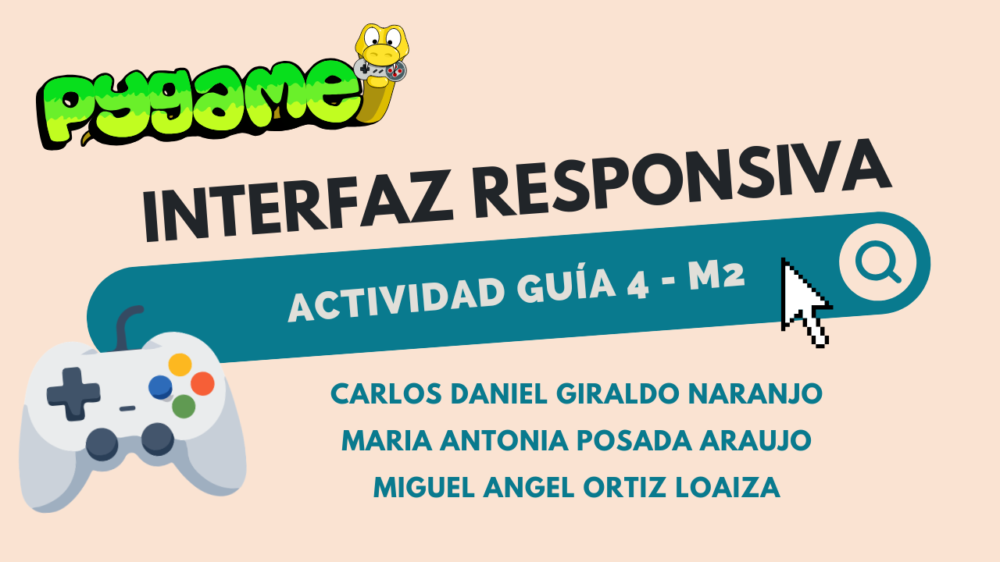

# Guía 4 - M2 - Desarrollo de una interfaz web responsiva 
****

## Introducción del proyecto
****

Este proyecto consiste en el desarrollo de una página web educativa/blog enfocada en la enseñanza de los fundamentos de programación de videojuegos bidimensionales (2D) utilizando la librería Pygame de Python. La plataforma tiene como propósito presentar de manera organizada los conceptos, herramientas y procedimientos necesarios para conocer los y comprender el desarrollo de videojuegos bidimensionales. Para esto, se incluyen fragmentos de código, ejemplos prácticos y explicaciones de la teoría, que permiten al usuario familiarizarse con los componentes principales de Pygame.

## Objetivo de la actividad
****

El objetivo consiste en crear una interfaz web educativa, intuitiva y visualmente organizada que permita a los usuarios consultar información sobre el desarrollo de videojuegos 2D en Pygame, facilitando la navegación entre los contenidos y garantizando una visualización adecuada en computadores y otros dispositivos.

## Enlaces del proyecto:
****

- Repositorio de Github con el código del proyecto: https://github.com/Ctrl-Angelus/Guia-4-
M2_Desarrollo-de-una-interfaz-responsiva
- Enlace al video de Youtube: https://youtu.be/xHsaPvMIvPY

## Cómo abrir la página web
****

Para abrir la página web, es posible utilizar el link de Github Pages: [Enlace a la página](https://ctrl-angelus.github.io/Guia-4-M2_Desarrollo-de-una-interfaz-responsiva/)
De igual forma es posible clonar el repositorio usando git, o descomprimiendo el .zip, posteriormente se debe abrir el archivo index.html
